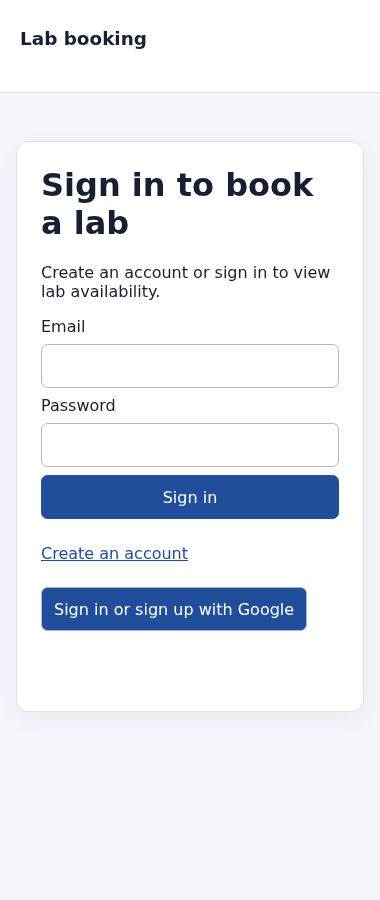
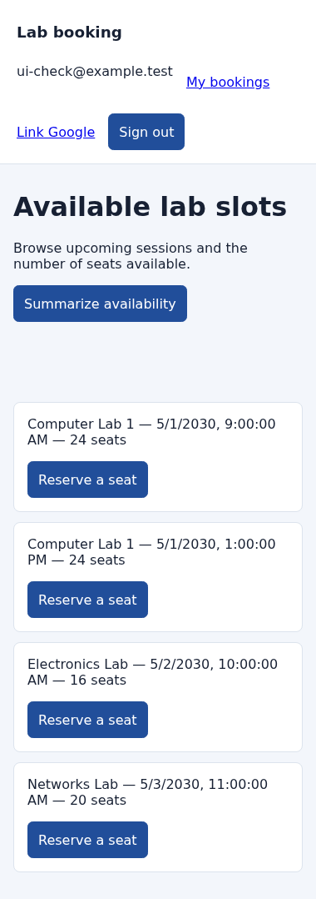
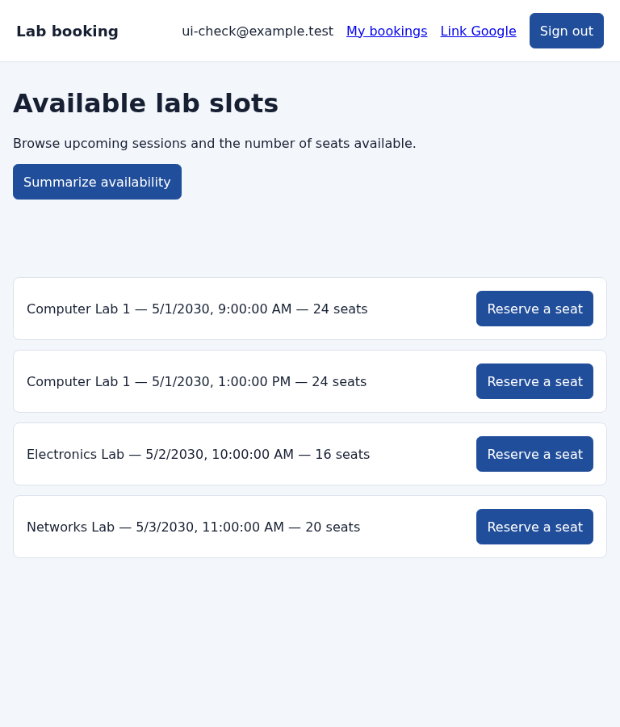
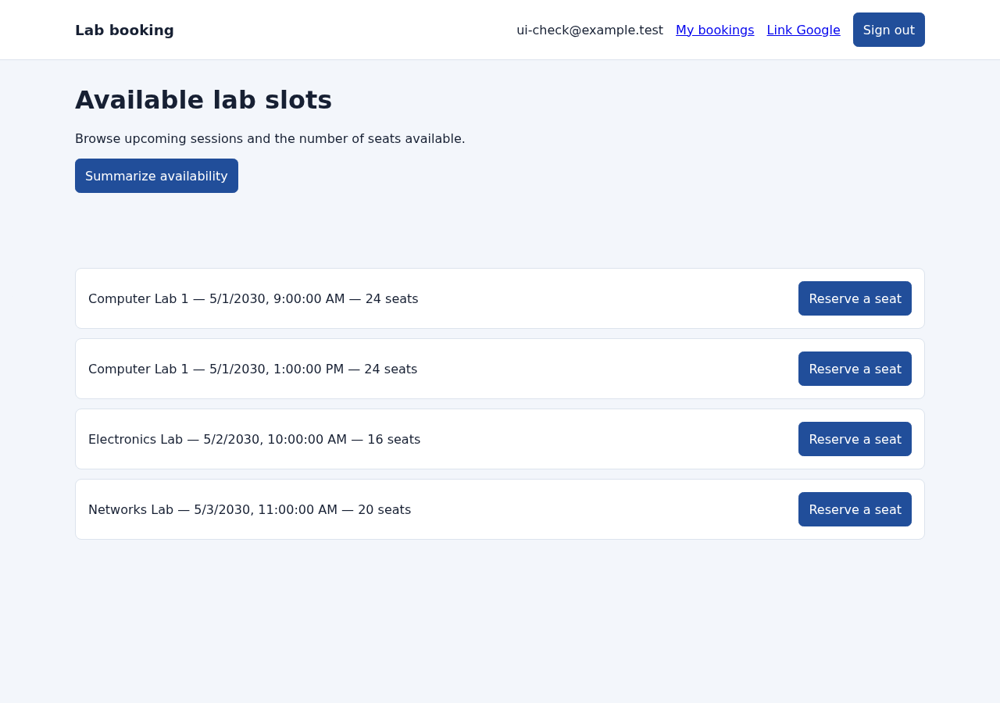
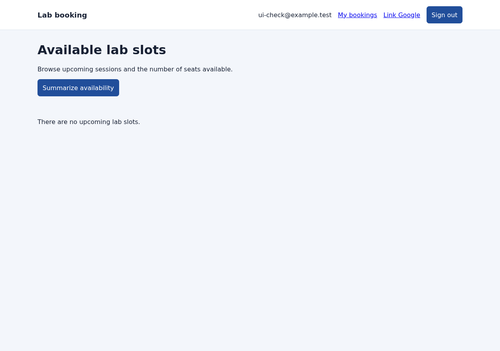
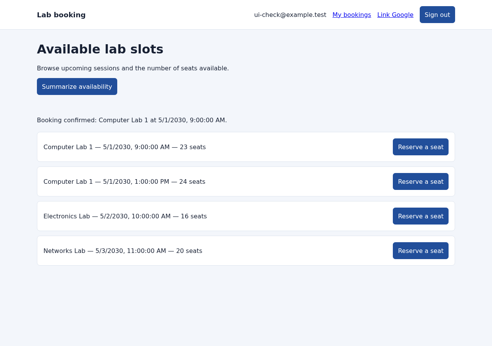
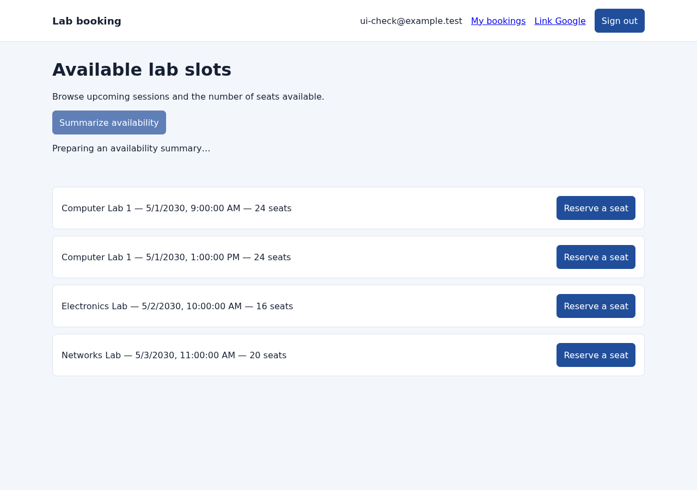

# UI checklist

<!-- Exercise 4 hands this in. Tick an item only when you have checked it, and replace
     the "how I checked" line with what you actually did. An unticked box is not a
     failure: it is a gap you then write into READINESS.md. A ticked box you cannot
     demonstrate at the defence is worse than an unticked one. -->

"Modern" is not a style. It is a short list of things a user notices when they are
missing: the screen tells you what is happening, you can get through it with a keyboard,
the text is readable, and nothing jumps around while it loads.

## Layout and typography

- [x] **One spacing scale and one type scale.** Sizes come from a small set of design tokens, not from numbers typed where they were needed.
  - how I checked: inspected the spacing, control-size, radius, and type tokens in `public/styles.css`; gaps, padding, and text sizes use those tokens.
- [x] **Responsive at 380, 768 and 1280 pixels wide.** No horizontal scrollbar, no text running under another element.
  - how I checked: Playwright 1.65.1 Chromium checked sign-in and availability at all three widths; `scrollWidth` matched the viewport and no content overflowed. Screenshots are linked below.
- [x] **Nothing jumps while the page loads.** Images and cards reserve their space before their content arrives.
  - how I checked: measured cumulative layout shift during an authenticated reload with a delayed slot response using the browser PerformanceObserver; score was 0.0063.

## The four states, on every screen

A screen that only handles "it worked" is a screen that lies to the user on the day it matters.

- [x] **Loading.** Something tells the user the app is working, within about 100 ms.
  - how I checked: inspected `public/app.js` and `public/my-bookings.js`; handlers update polite status text before awaiting requests.
- [x] **Empty.** The screen says what this list is for and what to do next, instead of showing nothing.
  - how I checked: inspected the empty-slot and empty-bookings messages in the browser scripts.
- [x] **Error.** A sentence a person can read. Never a raw JSON body, never a stack trace, never just "Error".
  - how I checked: inspected request error handling; it displays the API error message or a readable generic sentence.
- [x] **Success.** The user can see that what they did took effect, without reloading the page to find out.
  - how I checked: inspected the booking confirmation, signed-in view, and cancellation refresh flows.

## Lab discovery and management

The availability screen now has labeled laboratory and date filters with apply and clear actions. Managers can add a laboratory, see the lab list, then select an existing lab when creating a slot. Lab listing is available to signed-in students; only allowlisted managers can add labs or slots.

- how I checked: `test/slice-2.test.js` verifies filtering by lab and date; `test/manager-slots.test.js` verifies manager lab creation, listing, slot creation, and student denial. The screenshots below predate these new controls, so they are not visual evidence for this update.

## Keyboard and accessibility

- [x] **The main flow works with the keyboard alone.** Sign in, do the core action, sign out, without touching the mouse.
  - how I checked: Playwright keyboard-only test signed in, reserved a seat, opened My bookings, cancelled that booking, returned to availability, and signed out using Tab and Enter. This used an isolated in-memory SQLite database and a disposable test account.
- [x] **The focused element is visible.** A `:focus-visible` outline that is not switched off.
  - how I checked: inspected the `:focus-visible` rule in `public/styles.css`.
- [x] **Text contrast is at least 4.5:1.** Name the tool you measured with.
  - how I checked: a Node.js WCAG relative-luminance calculation measured body text at 15.02:1, button text at 8.01:1, and the focus outline at 5.01:1 against the page background.
- [x] **Every input has a label** a screen reader reads, not just placeholder text.
  - how I checked: inspected `public/index.html`; every form input has a matching `label for`.
- [x] **The page has a correct `<title>` and `lang`.**
  - how I checked: inspected both HTML pages; each declares `lang="en"` and a descriptive title.
- [x] **Touch targets are at least 44 pixels.**
  - how I checked: inspected `public/styles.css`; inputs, buttons, and navigation links have `min-height: 2.75rem` (44 CSS pixels at the default root size).

## The model feature

- [x] **It shows that it is thinking.** A model call is slow and a free service may have been asleep; a frozen button is the worst possible answer.
  - how I checked: inspected the disabled button and polite “Preparing an availability summary…” status in `public/app.js`.
- [x] **It shows when it failed,** and the rest of the screen still works.
  - how I checked: inspected the failure message; the database-backed slot list remains visible below it.
- [x] **The user can tell the model's suggestion from a fact.** It is labelled as a suggestion, not presented as data the app knows.
  - how I checked: inspected the response rendering in `public/app.js`; it prefixes generated text with “Availability suggestion”.

## Decisions

- [x] **Dark mode, or a written decision not to have one.**
  - what I decided and why: keep the light theme for this small course app; dark mode is outside the project goals and would add a second palette to maintain.

## Evidence

<!-- Screenshots of at least the four states of one screen, and of the model feature
     thinking and failing. A link to them is enough; they do not have to be in the repo. -->

These screenshots were captured in a local Chromium browser against an isolated in-memory database. Empty, error, and model responses were simulated; no production data was changed.

